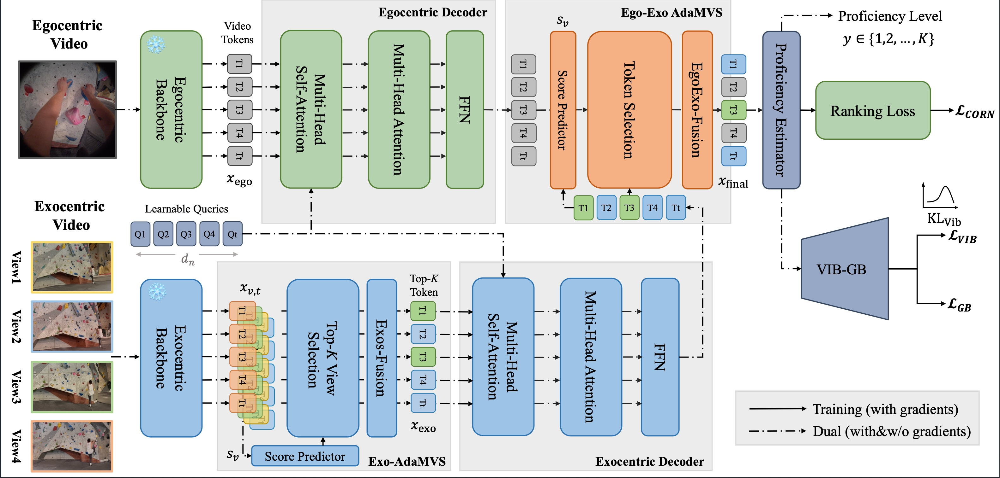

# AdaMVS

ECCV 2026: Moving Beyond More Views: Redundancy-Aware Ego–Exo Fusion for Proficiency Estimation

[](https://andrewjohngilbert.github.io/RedundEgoExo/) [](https://arxiv.org/abs/2608.25736)

## Introduction

Ego–Exo proficiency estimation combines fine-grained motion cues from
egocentric video with spatial context from multiple exocentric cameras.
However, simply adding more exocentric views can *degrade* performance:
redundant or noisy perspectives dilute discriminative information and
enlarge the feature space, encouraging view-specific overfitting.

**AdaMVS** addresses this by adaptively identifying and fusing the most
informative view tokens, without requiring explicit view-level labels.
It is paired with **VIB-GB**, which applies information-bottleneck
regularization combined with gradient blending to suppress redundancy and
balance learning across the ego and exocentric streams. Together they
achieve state-of-the-art results on EgoExo-4D (53.0% accuracy) and
EgoExo-Fitness (48.8% accuracy).



## Setup

```bash
conda create -n adamvs python=3.8
conda activate adamvs
conda install pytorch==2.4.1 pytorch-cuda=11.8 -c pytorch -c nvidia
pip install -r requirements.txt
```

## Data

This repo does **not** ship any data or feature files. `train.py` reads
pre-extracted, per-clip backbone features from disk — you must point every
config at your own data directory before training. Every config in
`configs/` has a block with the paths to edit:

```python
presave_path    = "./data/..."                              # required, per pretrain source (k400/k600/howto100)
train_anno_path = "./data/demonstrator_simple_train.json"    # egoexo4d only
test_anno_path  = "./data/demonstrator_simple_test.json"     # egoexo4d only
```

`presave_path` must point at a directory containing `<presave_path>_ego/`,
`<presave_path>_exo1/`, ... subdirectories, each holding the same clips as
`.npz` files split into `train/` and `test/`. Each `.npz` stores `a` (feature
tensor), `b` (proficiency label) and `c` (raw sample/action name).

Pre-extracted features (`data.tar`, matching the `./data/...` layout above)
are available for download:

- Google Drive: https://drive.google.com/file/d/10abaiIJDZCmlj6lxpq90OGK9SM45IBtZ/view?usp=sharing
- Baidu Disk: https://pan.baidu.com/s/10HOfPx3DfILw31hhOGG4Ow (提取码: mi52)

## Training

```bash
python train.py --config configs/egoexo4d.py
```


## Structure

```
train.py            # train + eval entry point (one epoch = full train pass + full test pass)
utils.py             # seeding, GPU setup, config/CLI parsing, logging
dataloader/          # EgoExo4d / EgoExoFitness feature datasets
models/
  neck.py            # TQN: redundancy-aware ego/exo fusion (the core method)
  transformer.py      # DETR-style decoder used by the neck, incl. exo-view gating
  head.py             # classification head + VIB / view-weighting sub-modules
configs/              # one .py config per dataset/backbone combination
```


## Citation

If you find our work useful, please consider starring the repo and citing our paper:

```bibtex
@inproceedings{dong2026moving,
  title     = {Moving Beyond More Views: Redundancy-Aware Ego-Exo Fusion for Proficiency Estimation},
  author    = {Dong, Xu and Li, Wanqing and Adeyemi-Ejeye, Anthony and Gilbert, Andrew},
  booktitle = {European Conference on Computer Vision (ECCV)},
  year      = {2026}
}
```

Contact: xd00101@surrey.ac.uk
